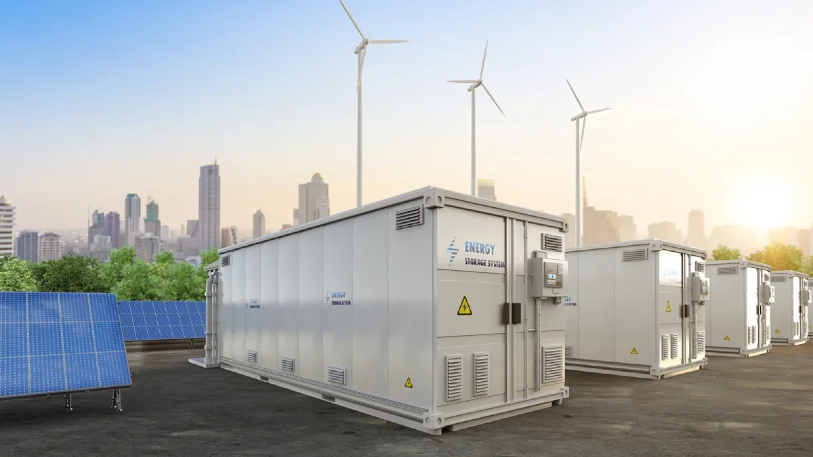

# GB Power Price Sandbox



**How much battery revenue does forecast error cost, and do quantile forecasts win some of it back?**

A multi-tab Streamlit app for exploring GB wholesale power prices, backtesting probabilistic
day-ahead price forecasts, and optimising battery dispatch against them.

Headline metric: **capture rate** = revenue from forecast-driven dispatch ÷ revenue with perfect
foresight.

## Results

Baselines. Walk-forward backtest over delivery days from 2023-01-01 to 2026-10-31, with all of
2022 as the initial training year and weekly retraining. Every forecast is issued at 10:00 on D-1.

| Model | MAE (£/MWh) | RMSE (£/MWh) | Battery capture rate, Nov 2025 to Oct 2026 |
|---|---|---|---|
| Seasonal naive (same half-hour last week) | 27.8 | 43.8 | 47% |
| LEAR (per-half-hour LASSO, asinh prices, demand and wind forecasts) | 20.0 | 29.9 | 71% |

The battery is 1 MW / 2 MWh, 88% round trip, at most 1 cycle per day, doing wholesale
arbitrage at MID, scored on the 350 days with complete data. Perfect foresight earns about £39k
over those 12 months, so LEAR's forecast errors cost about £11k of it. Errors are largest around
midday, which points to solar as the next feature to try.

The quantile models (linear quantile regression, QRA, LightGBM, quantile forest, MSTL, SARIMAX)
can be trained and compared in the Forecast sandbox, but aren't benchmarked here yet, so the
second half of the question is still open.

## How to run

Requires [uv](https://docs.astral.sh/uv/) (Python 3.12 is fetched automatically if missing).

```bash
uv sync                                  # create .venv and install deps
uv run pre-commit install                # enable git hooks
uv run python -m gb_price_sandbox.pretrain  # forecasts for the Battery page (<1 min)
uv run streamlit run app/Home.py         # launch the app
uv run pytest                            # tests (offline)
uv run pytest -m network                 # live API smoke tests
uv run ruff check . && uv run ruff format --check .
```

Configuration is via environment variables (prefix `GBPS_`); see `.env.example`.

### Docker

```bash
docker build -t gb-price-sandbox .
docker run --rm -p 8501:8501 -v "$PWD/data:/app/data" -e PRETRAIN_ON_START=1 gb-price-sandbox
```

`PRETRAIN_ON_START=1` refreshes the Battery page's forecasts before serving (about 35 s, cached
afterwards).

### Deploy to Google Cloud

Cloud Run, set up for minimum cost: the app scales to zero when idle (so the first visit after a
quiet spell is slower), a Cloud Run Job refreshes the Battery forecasts daily at 10:15 London
time, and both share a Cloud Storage bucket mounted at `/app/data`, so no code changes are needed.

```
Cloud Scheduler (10:15 London) ──► Cloud Run Job: pretrain ──writes──► GCS bucket
Users ──► Cloud Run Service: Streamlit app ◄──reads── (mounted at /app/data)
```

First deploy (needs `gcloud` installed and logged in, and a project with billing):

```bash
PROJECT=my-project deploy/gcp.sh setup seed build service job schedule
```

The steps, each safe to re-run:

| Step | What it does |
|---|---|
| `setup` | Enables APIs; creates the bucket, a runtime service account and the image repository; grants permissions |
| `seed` | Uploads your local `data/` cache to the bucket, so nothing is re-downloaded |
| `build` | Builds the image with Cloud Build |
| `service` | Deploys the app (scale to zero, at most one instance) and prints its URL |
| `job` | Deploys the daily pretrain job and runs it once |
| `schedule` | Creates the daily trigger |

Shipping new code afterwards: `PROJECT=my-project deploy/gcp.sh build service job`, or connect a
Cloud Build trigger on pushes to `main` using `deploy/cloudbuild.yaml`. Settings (`REGION`,
`BUCKET`, `PUBLIC`, `MAX_INSTANCES`, ...) are environment variables at the top of
`deploy/gcp.sh`. `PUBLIC=false` keeps the app private, e.g. behind Identity-Aware Proxy; worth
it before sharing widely, since anyone can press Train in the Forecast sandbox.

## Project layout

```
src/gb_price_sandbox/
  config.py        settings from env vars
  data/            API loaders + idempotent parquet cache
  features/        point-in-time forecast vintages, model dataset (issue-time safe),
                   feature catalogue for the Features tab
  models/          naive baselines, LEAR, MSTL, SARIMAX, linear quantile regression, QRA,
                   LightGBM (light/heavy), quantile regression forest; registry with families
  backtest/        walk-forward validation
  metrics.py       MAE, pinball, coverage, CRPS
  optimise/        battery MILP (PuLP + HiGHS), capture-rate evaluation
  merit_order.py   stylised supply stack for the Background tab
  viz/             Plotly figures (shared theme, fixed colour per model)
  app_data.py      the functions the Streamlit pages call
app/               Streamlit pages (UI only)
deploy/            Google Cloud Run deployment (gcp.sh, cloudbuild.yaml)
tests/
```

## Data sources

- **Elexon Insights API:** Market Index Price (half-hourly, day-ahead proxy) and system price.
- **Elexon Insights API (NESO forecasts):** national demand forecast (NDF, half-hourly) and wind
  generation forecast (WINDFOR, hourly), with every published vintage time-stamped, so features
  are built only from forecasts available at the D-1 issue time. Coverage starts in 2022, which sets
  the study period. (The NESO portal's "historic" files are unsuitable: they keep one revision per
  period, often published after delivery.)
- **Open-Meteo** historical forecasts: solar irradiance and temperature at a handful of GB sites,
  combined with fixed weights. The archive is built from the first hours of each model run, so
  it is a short-lead forecast, a little better than one made on D-1. It's used for exploration
  only (Features tab), not in the backtest. Free for non-commercial use.
- **PV_Live** (Sheffield Solar): estimated national solar generation, half-hourly.
- **GOV.UK bank holidays** (England and Wales).
- No gas or carbon price series yet: there's no free API for NBP or UKA prices.

## Limitations

_To come._

## How this was built

Much of the code was written with [Claude Code](https://claude.com/claude-code), Anthropic's
coding agent, working from the brief in `CLAUDE.md`. One guardrail is enforced rather than just
requested: Claude never commits. Deny rules in `.claude/settings.json` block `git commit`,
`push`, `merge`, `rebase`, `cherry-pick`, `revert` and `am`, so every change is left in the
working tree for a human (James) to review and commit.
